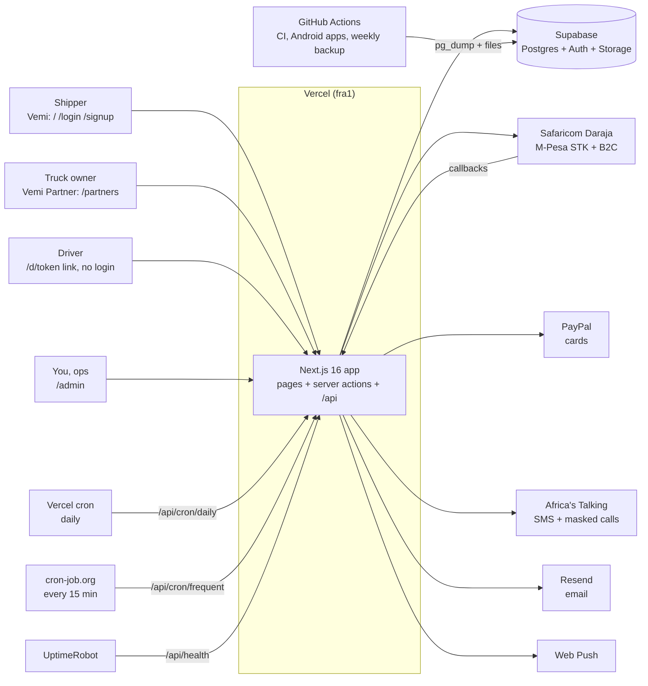

# Vemi Logistics system design: a study guide

Vemi is an "Uber for trucks" for East Africa. Businesses that need goods moved post a load. Verified truck owners bid on it or book it at the guide price. The shipper pays by M-Pesa, card or bank, and follows the truck on a map. The carrier is paid to M-Pesa once delivery is confirmed.

This guide explains how Vemi is built and why, in plain language, for one engineer running it alone. Each part says whether it is **live on main** (merged) or **pending in PR #6** (waiting on your "merge").

Status on 2026-11-18:
- `main` is at `90b2743` (PR #5).
- [PR #6](https://github.com/Ivula-Technologies/Vemi-Logistics/pull/6) is open. It adds the two portals and the operations work in this guide.
- The live site, `vemi-logistics.vercel.app`, shows "Vemi is getting ready" until the Supabase keys are set on Vercel (GO-LIVE-ON-VERCEL.md, Part A).

---

## 1. The big picture



**The idea in one sentence:** one Next.js app does all the work, and everything hard (database, sign-in, files, payments, SMS, email) is handed to a managed service. You have no server to patch.

This shape is a **modular monolith**: one codebase and one deploy, split into tidy folders. It is the right shape for a solo engineer. Microservices would add networking, deploys and failure points with nothing gained at this size.

**The second idea:** the database is the referee. Every rule that touches money or trip state (who may bid, booking, assigning a truck, confirming delivery, paying out) is a Postgres function guarded by row-level security. The screens hide buttons, but the database is what actually says no. A bug in a page cannot move money it shouldn't.

---

## 2. The stack and why each piece was chosen

| Piece | What it does | Why this one |
|---|---|---|
| **Next.js 16** (App Router, React 19, TypeScript) | Pages, server actions and API routes in one project | One language and one deploy for the front and back end |
| **Tailwind + shadcn/ui** | Styling and UI parts | Fast to build, mobile-first |
| **Supabase** | Postgres, sign-in (email, magic link, optional Google and phone code), private file storage | Managed. Row-level security keeps each company's data apart inside the database. |
| **Vercel** (Hobby, Frankfurt) | Hosting, preview links per PR, the daily cron | Deploys on every merge to main with nothing to upload. Frankfurt is closest to Supabase's EU region. |
| **M-Pesa Daraja** | STK push (shipper pays) and optional B2C (carrier payout) | How East Africa pays. Up to KES 250k per prompt; bank transfer above that. |
| **PayPal** | Card payments | Works without a US company |
| **Africa's Talking** | SMS and optional masked calls | Kenyan provider with local sender IDs; contacts stay hidden until a trip is paid |
| **Resend** | Email | Simple API, idempotency keys stop double sends |
| **Web Push (VAPID)** | Phone notifications from the installed app | Free and needs no app store |
| **Bubblewrap TWA** | Android apps (Vemi and Vemi Partner) | The website, full screen, as a Play app. One codebase. |
| **vitest + SQL tests** | 43 unit tests, 5 database test files | Covers pricing, money, return loads, portals, ops and every database rule |

---

## 3. Two portals, one app

| | Vemi (customers) | Vemi Partner (truck owners) |
|---|---|---|
| Front door | `/` | `/partners` |
| Sign-in and sign-up | `/login`, `/signup` (shipper accounts) | `/partners/login`, `/partners/signup` (carrier accounts) |
| Look | Light, "LOGISTICS" wordmark | Orange sign-in, night-blue header, "PARTNER" wordmark |
| Language | English | English or Kiswahili (`vemi_lang` cookie) |
| Installable app | `/manifest.webmanifest`, Android `com.ivulatechnologies.vemi` | `/partners/manifest.webmanifest`, Android `com.ivulatechnologies.vemi.partner` |
| Status | Live on main | **Pending, PR #6** |

Both portals share one database and one set of accounts. The role on the profile (`shipper`, `carrier` or `admin`) decides which screens a person sees. A cookie, `vemi_portal`, remembers the last front door so "please sign in" and sign-out land people in the right place. See `src/lib/portal.ts`.

Drivers have no account. Each trip has a secret link (`/d/<token>`), sent by SMS or WhatsApp, where the driver taps each step, shares location and uploads the delivery photo.

---

## 4. The data model

38 tables in `public`, created by five migrations that you run in date order:

1. `20261025090000_vemi_core.sql`: the marketplace
2. `20261025120000_uber_features.sql`: wallet, promos, business accounts and more
3. `20261028090000_border_papers.sql`: border papers
4. `20261028120000_part_loads.sql`: shared trucks
5. `20261118090000_ops.sql`: **pending, PR #6**

The main groups:

| Group | Tables | Notes |
|---|---|---|
| People | `profiles`, `carriers`, `carrier_private`, `carrier_documents`, `team_members`, `team_invites`, `business_accounts` | A carrier is verified by a person (ID, KRA PIN, logbook, inspection, insurance) before they can bid |
| Fleet | `trucks`, `drivers`, `truck_availability` | |
| Marketplace | `loads`, `load_stops`, `load_contacts`, `bids`, `favourite_carriers`, `saved_places`, `places` | `places` is the list of towns and border posts the guide price uses |
| Trips | `trips`, `trip_events`, `trip_locations`, `trip_documents`, `trip_charges`, `messages`, `ratings`, `voice_calls` | One trip per booked load. `trip_events` is the timeline. |
| Money | `payments`, `payouts`, `refunds`, `wallet_entries`, `promo_codes`, `promo_redemptions`, `referral_rewards`, `platform_settings` | Amounts are whole shillings (integers), never floats |
| Sign-in extras | `login_codes`, `push_subscriptions` | |
| Operations (PR #6) | `app_events`, `app_status`, `rate_limits` | Server-only: row-level security on, no policies |

**Trip status, in order:** `awaiting_payment` → `scheduled` → `to_pickup` → `loaded` → `in_transit` (→ `at_border`) → `delivered` → `completed`. A trip can also be `disputed` or `cancelled`. Only database functions move a trip along. The app never writes `status` directly.

**Files** live in four private Storage buckets: `carrier-docs`, `photos`, `pod` (proof of delivery) and `trip-docs` (border papers). Every file sits in a folder named after its owner or trip, and storage policies check that folder. People only ever get short-lived signed links (`/api/files/...`).

---

## 5. Security and access

- **Row-level security on every table.** A shipper sees their own (or their business's) loads and trips. A carrier sees open loads and their own trips. Contacts and addresses stay hidden until the trip is paid.
- **Money and state changes are `security definer` functions** with explicit `grant execute`. Examples are `instant_book`, `assign_trip`, `confirm_delivery`, `apply_mpesa_payment` and `run_daily_jobs`. Each re-checks who is asking.
- **The service role key** (`SUPABASE_SECRET_KEY`) is only used on the server, in webhooks, cron jobs and driver links. It never reaches a browser.
- **Webhooks and crons prove who they are.** The M-Pesa callback carries a secret token, compared in constant time. Cron calls carry `Authorization: Bearer CRON_SECRET`, which Vercel cron sends by itself.
- **Driver links** are long random tokens. Only that trip's driver actions are possible through them.
- **Rate limits (PR #6).** See section 9.

---

## 6. How a load becomes a paid trip

1. **Post.** The shipper enters the route, cargo, truck type and date. The guide price is shown at once: 1.25 × straight-line km × the per-truck rate, plus KES 15,000 per border, plus busy-lane and urgent surcharges (`src/lib/pricing.ts`). A part load (sharing a truck) is priced from the tonnes used.
2. **Bid or book.** Verified carriers with the right truck type get an alert (favourites first, then everyone after a short window). They bid, or book at the guide price with `instant_book`.
3. **Book a bid.** The shipper picks a bid, and the database creates the trip (`awaiting_payment`).
4. **Pay.** By M-Pesa (STK prompt, can be paid in parts), PayPal card, wallet credit, or bank transfer that ops records. Once paid in full the trip becomes `scheduled` and the carrier is told.
5. **Dispatch.** The carrier assigns a truck and driver (`assign_trip` checks the truck isn't overloaded with part loads). The driver gets the trip link.
6. **Drive.** The driver taps each step. Location pings every minute while the page is open. Border papers ride along. The shipper can share a tracking link (`/t/...`).
7. **Deliver.** The driver uses the delivery code and photo. The shipper confirms, or the daily job confirms it automatically after the waiting time.
8. **Pay the carrier.** A payout is queued for the trip price minus commission (10%, or 5% for founding carriers). You pay it by bulk M-Pesa file from Admin → Payouts, or by B2C if it is switched on.

---

## 7. Payments, and why nothing is paid twice

**M-Pesa STK (`/api/mpesa/checkout` → `/api/mpesa/callback`):**
- A row in `payments` with the `checkout_request_id` is written for every prompt. At most 5 prompts per trip in 10 minutes.
- The callback is **idempotent**. It acts only on a payment still `pending`, and `apply_mpesa_payment` locks the row, so Safaricom retrying the same callback changes nothing the second time.
- An amount below what was asked is not applied. It is failed, logged and investigated.
- If the database is down, the callback answers 500, so Safaricom retries. A paid shilling can't be lost.
- `/api/mpesa/status` asks Safaricom directly when a callback never arrives.

**PayPal:** the order is captured on return and checked against the trip and amount with PayPal itself. Each PayPal order ID is unique on `payments`, and `apply_paypal_payment` records it once.

**Payouts:** one payout per trip and kind, created inside `confirm_delivery`. A dispute sets it to `held`. B2C results come back to `/api/mpesa/b2c/result` and are retried by Safaricom on a 500.

**Emails** about money carry Resend idempotency keys. Notifications carry a `key` so a retried job doesn't send the same SMS twice.

---

## 8. Background jobs (cron)

There are no queues or worker servers. There are two jobs, both safe to run twice:

| Job | Schedule | What it does |
|---|---|---|
| `/api/cron/daily` | 03:00 UTC (06:00 Nairobi) by **Vercel cron** (`vercel.json`) | Confirms deliveries nobody answered (queuing payouts), expires stale loads, sends pickup reminders (carrier and driver), document-expiry reminders, overdue-invoice reminders and missing-border-paper reminders. **PR #6** adds the error digest email, error-log housekeeping and "last ran". |
| `/api/cron/frequent` | Every 15 minutes, from **cron-job.org** (Vercel Hobby only allows daily crons) | Truck watch (no signal or stopped too long: alerts ops and the carrier). Announces loads once the favourites-first window closes. **PR #6** adds "last ran". |

Most of the work is a single database function (`run_daily_jobs`, `run_watch_jobs`), so the job is one round trip and the rules live with the data.

---

## 9. Rate limiting (pending in PR #6)

Vercel runs many short-lived copies of the app, so a counter kept in memory would reset all the time. Vemi's limits are counted in Postgres instead (`hit_rate_limit`, one row per key, locked while it counts). That holds across every copy.

| What | Limit | Key |
|---|---|---|
| Password sign-in | 20 per 10 min | visitor IP |
| Sign-up | 10 per hour | visitor IP |
| Magic sign-in link | 5 per 15 min | visitor IP |
| Phone sign-in code | 10 per 15 min per IP (plus the existing 3 codes and 5 wrong tries per phone) | IP and phone |
| Public quote API `/api/v1/quote` | 120 per 10 min | visitor IP |
| Driver link: masked call | 10 per hour | trip link |
| Driver link: SOS | 5 per 10 min | trip link |
| Driver link: chat | 30 per 10 min | trip link |
| M-Pesa prompts | 5 per trip per 10 min | trip (live on main) |

If the database can't be reached, the limiter lets the request through. A broken limiter should never lock people out. Supabase Auth also has its own limits on emails and sign-ins.

---

## 10. Errors and monitoring

**Live on main:**
- `/api/health` checks that every required setting exists and the database answers. It returns 503 if not, and only ever shows names, never values.
- Safaricom retries failed callbacks. Vercel keeps function logs.

**Pending in PR #6:**
- **Error log in the database.** `reportError()` in `src/lib/ops.ts` writes server errors to `app_events` as well as the Vercel log. It is wired into the M-Pesa callback, STK push, B2C results, PayPal capture and both crons. It is capped at 30 a minute per server copy so an error storm can't flood the database, and it never throws.
- **Daily error email.** On days with errors, the daily cron emails `VEMI_OPS_EMAIL` a digest grouped by where and what, top 10 first. Clean days send nothing. Rows older than 30 days are deleted.
- **Cron watch.** `/api/health` now shows `dailyCron` (`ok`, `late` or `never`) and turns red if it hasn't run for 26 hours. It also shows `watchCron` (information only) and `errorsLastDay`.
- **UptimeRobot** (free) checks `/api/health` every 5 minutes and emails you when it goes red. You set it up once.

**Why not Sentry or Datadog?** Each is another account, another bill and another dashboard to watch. One digest email plus one uptime alert covers this size. Add Sentry when paying customers need faster answers.

---

## 11. Backups and restore (pending in PR #6)

Supabase's free plan has no backups you can download, and database backups never include stored files. `.github/workflows/backup.yml` covers both:

- It runs every Sunday at 01:30 Nairobi time, and by hand from Actions → **Weekly backup**.
- `pg_dump` (Postgres 17) saves the `public` and `private` schemas, plus the sign-in accounts (`auth.users`, `auth.identities`, data only).
- `scripts/backup-storage.mjs` downloads every file in every bucket.
- Everything is put in one tar file, encrypted with AES-256 using `BACKUP_PASSPHRASE`, and kept as a workflow artifact for 35 days.
- It skips with a warning until you add four repository secrets:
  - `SUPABASE_DB_URL`: the Session pooler connection string, from Supabase → Connect
  - `SUPABASE_URL`
  - `SUPABASE_SECRET_KEY`
  - `BACKUP_PASSPHRASE`

**Write `BACKUP_PASSPHRASE` down somewhere safe.** Without it, a backup can't be opened.

**Restore into a fresh Supabase project:**
```
gpg --decrypt vemi-backup-DAY.tar.gz.gpg > backup.tar.gz && tar -xzf backup.tar.gz
pg_restore --no-owner --dbname "$NEW_DB_URL" DAY/vemi-app.dump
pg_restore --data-only --no-owner --dbname "$NEW_DB_URL" DAY/vemi-auth.dump
```
Then upload the folders under `DAY/storage/<bucket>/` back into buckets of the same names. Practise this once on a spare project, so you know it works before you need it.

---

## 12. Deploying

1. Merge a PR to `main`. Vercel builds and deploys it in about two minutes. Every PR also gets its own preview link.
2. If the PR has a new migration, paste it into Supabase's SQL Editor and run it. Run migrations in date order. They are written to be run once.
3. Environment variables live in Vercel → Settings → Environment Variables. A change needs a redeploy. The full list is in `.env.example`. Optional keys switch features on by themselves (DEPLOY.md section 6).
4. The Android apps are built by Actions → **Build Android App** (both apps), then uploaded to Play Console. Testers' APK is rebuilt automatically into `public/download/`.

`main` is the only long-lived branch. Each change is one PR, deleted after merging.

---

## 13. Known limits, and when to change things

| Limit today | Fine until about | What to do then |
|---|---|---|
| Vercel Hobby: daily crons only, non-commercial terms | Your first paying customers | Vercel Pro ($20/month): commercial use, cron every minute (drop cron-job.org), team features |
| Supabase free: 500 MB database, 1 GB files, pauses after a week idle, no downloadable backups | Real trips running daily | Supabase Pro ($25/month): daily backups and no pausing. The GitHub backup becomes your second copy. |
| Bulk M-Pesa payout file by hand | About 30 payouts a day | Switch on B2C (the code is there; needs Safaricom's B2C approval) |
| Postgres rate limits (one row per key) | Thousands of requests a minute | Vercel Firewall rules or Upstash Redis |
| Location pings stored for every trip | About 1 million rows | Thin out old `trip_locations` (keep one point per 10 min after delivery) |
| Error digest by email | A handful of customers | Sentry for instant alerts with stack traces |
| Kenyan mobile money only | Expanding to Uganda, Tanzania, Rwanda | MTN MoMo and Airtel Money, or a pan-African gateway |

**The rule of thumb:** don't scale ahead of real pain. Each row above is a change you can make in a day, when the numbers say so.

---

## 14. Live vs pending, at a glance

| Part | Status |
|---|---|
| Marketplace: loads, bids, instant book, trips, tracking, ratings | Live on main |
| M-Pesa STK, PayPal, wallet, bank transfer, payouts (bulk file + optional B2C) | Live on main |
| Border papers, part loads, return loads, Kiswahili for carriers | Live on main |
| Health check, idempotent M-Pesa callbacks, per-trip prompt limit | Live on main |
| Two portals (Vemi and Vemi Partner) and the second Android app | **Pending, PR #6** |
| Google sign-up keeps the portal's account type | **Pending, PR #6** |
| Error log + daily error email | **Pending, PR #6** |
| Cron watch in `/api/health` | **Pending, PR #6** |
| Rate limits on sign-in, sign-up, quote API and driver links | **Pending, PR #6** |
| Weekly encrypted backup (database + files) | **Pending, PR #6** |

**After you merge PR #6:**
1. Run `20261118090000_ops.sql` in Supabase. The all-in-one SQL for a new project already includes it.
2. Make sure `VEMI_OPS_EMAIL` is set.
3. Open `/api/cron/daily` once, or wait for 06:00 Nairobi, so `dailyCron` turns `ok`.
4. Add the four backup secrets and run **Weekly backup** once.
5. Add the UptimeRobot monitor.

---

## Where to look in the code

| To understand… | Read |
|---|---|
| The database and its rules | `supabase/migrations/` (in date order), tests in `supabase/tests/` |
| Prices | `src/lib/pricing.ts`, `src/lib/part-loads.ts` |
| Commission and payouts | `src/lib/commission.ts`, `src/app/(app)/admin/payouts/` |
| M-Pesa | `src/lib/mpesa.ts`, `src/app/api/mpesa/` |
| Notifications (push, email, SMS) | `src/lib/notify.ts`, `src/lib/trip-notify.ts` |
| The two portals | `src/lib/portal.ts`, `src/app/partners/`, `src/lib/supabase/middleware.ts` |
| Errors, cron watch, rate limits | `src/lib/ops.ts`, `src/lib/ops-core.ts`, `src/app/api/health/route.ts` |
| Jobs | `src/app/api/cron/daily`, `src/app/api/cron/frequent` |
| The driver's link | `src/app/d/`, `src/app/api/driver/` |
| Backups | `.github/workflows/backup.yml`, `scripts/backup-storage.mjs` |
